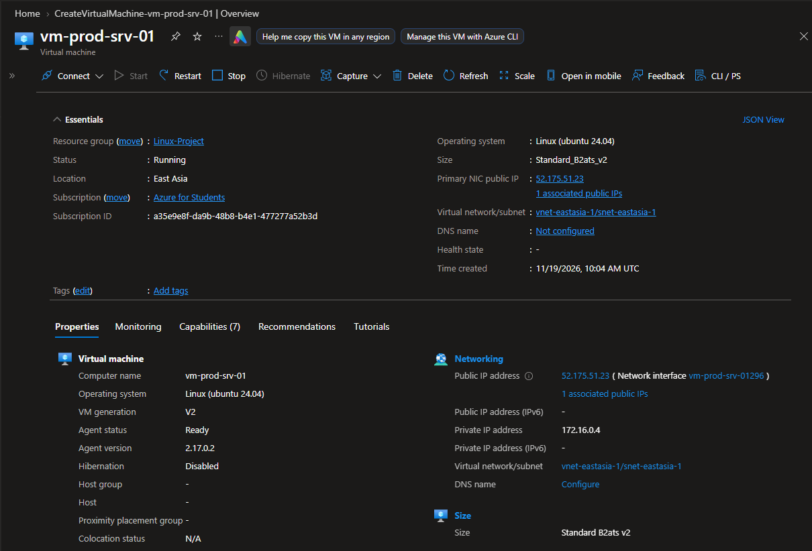
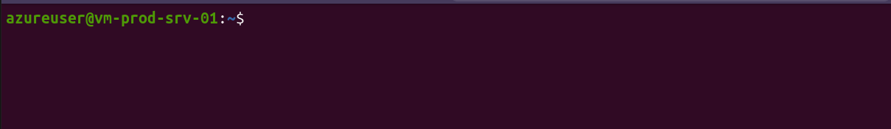
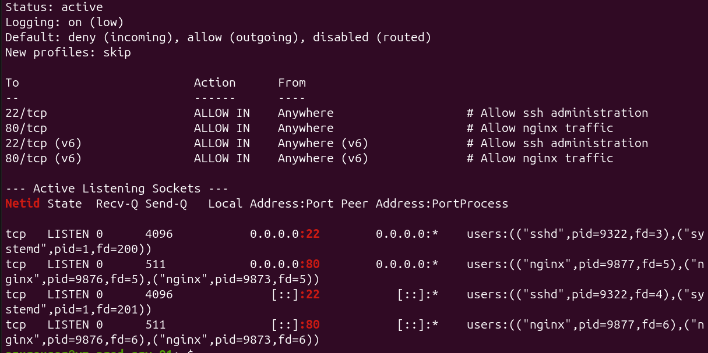

# Secure Linux Server Administration and Management

A hands-on, enterprise-grade Linux infrastructure administration project simulating the provisioning, access control, hardening, and operational management of a production Ubuntu server (**NexaCore Technologies**).

---

## Architecture & Environment

This lab uses a **hybrid client-server architecture** separating the administrator's local workstation from the remote cloud production server:

* **Administrator Workstation (`noebl@nobel`):** Local Ubuntu VM used for remote SSH administration, configuration management, and Git version control.
* **Managed Cloud Server (`vm-prod-srv-01`):** Microsoft Azure Virtual Machine running **Ubuntu Server 24.04 LTS** (`Standard_B2ats_v2`), managed remotely over encrypted SSH sessions.

```text
+-----------------------------------+          +---------------------------------------------+
|   ADMIN WORKSTATION (Local VM)    |          |      MANAGED CLOUD SERVER (Azure VM)        |
|        Hostname: nobel            |   SSH    |         Hostname: vm-prod-srv-01            |
|        User: noebl                +==========+->       OS: Ubuntu Server 24.04 LTS         |
+-----------------------------------+  TCP/22  |                                             |
                                               |  - Departmental Groups & Least-Privilege    |
                                               |  - SGID Shared Directories (/srv/nexacore)  |
                                               |  - Hardened SSH, UFW, systemd & Backups     |
                                               +---------------------------------------------+
```

---

## Repository Structure

```text
secure-linux-server-admin/
├── configs/
│   └── nexacore-sysadmins.sudoers    # Sanitized sudoers privilege policy
├── docs/
│   ├── azure-vm-overview.png         # Azure VM deployment verification
│   ├── phase1-baseline.txt           # Workstation network baseline output
│   ├── phase1-SSH-baseline.png       # Initial SSH connection & resource check
│   ├── phase2-users-sudo.png         # Group, user, and sudo verification proof
│   └── phase3-permissions.png        # Directory permissions & access test proof
├── scripts/                          # Administrative automation scripts (upcoming)
├── .gitignore                        # Excludes private SSH keys and sensitive files
└── README.md                         # Complete project documentation
```

---

## Implementation Progress

* [x] **Phase 1:** Hybrid Infrastructure Setup & Baseline Profiling
* [x] **Phase 2:** Identity, Group Architecture & Least-Privilege `sudo`
* [x] **Phase 3:** Shared Filesystem Hierarchy, Permissions & SGID Inheritance
* [x] **Phase 4:** Package & Software Lifecycle Management (`APT`)
* [x] **Phase 5:** SSH Key-Based Authentication & Daemon Hardening
* [x] **Phase 6:** Host Firewall (`UFW`) & Perimeter Hardening
* [ ] **Phase 7:** Service Lifecycle (`systemd`), Networking & Log Diagnostics (`journalctl`)
* [ ] **Phase 8:** Automated Backups (`tar`/`rsync`), Bash Health Checks & `cron`

---

## Phase 1: Hybrid Infrastructure Setup & Baseline Profiling

### Objective
Provision a remote cloud server, establish encrypted remote connectivity from the administrator workstation, and verify baseline compute, memory, storage, and network states.

### Key Actions & Verification
1. **Workstation & Repository Initialization:** Created a structured Git workspace on `noebl@nobel` with `.gitignore` rules protecting private key patterns (`*.pem`, `*.key`, `id_ed25519*`) and verified local NIC reachability (`enp0s3`).
2. **Cloud Server Provisioning:** Deployed `vm-prod-srv-01` on Microsoft Azure running **Ubuntu 24.04 LTS** with inbound SSH (`TCP/22`) enabled.
3. **Remote SSH & Resource Audit:** Connected from the workstation via SSH (`azureuser@vm-prod-srv-01`) and verified OS release, kernel build, RAM availability (`free -h`), and root disk capacity (`df -h /`).




---

## Phase 2: Identity, Group Architecture & Least-Privilege `sudo`

### Objective
Implement role-based identity isolation across three company departments while enforcing the **Principle of Least Privilege**.

### Departmental Access Matrix

| Employee Account | Primary Group | Supplementary Group | Shell | `sudo` Privileges | Operational Role |
| :--- | :--- | :--- | :--- | :--- | :--- |
| `dev-jason` | `dev-jason` | `developers` | `/bin/bash` | Denied | Application development |
| `sys-lucia` | `sys-lucia` | `sysadmins` | `/bin/bash` | Full (`%sysadmins`) | Server operations & admin |
| `aud-author` | `aud-author` | `auditors` | `/bin/bash` | Denied | Read-only compliance auditing |

### Key Actions & Verification
1. **Group & Account Provisioning:** Created departmental groups (`developers`, `sysadmins`, `auditors`) with `groupadd` and provisioned employee accounts with dedicated home directories (`useradd -m -s /bin/bash -G <group>`).
2. **Modular `sudo` Delegation:** Configured `/etc/sudoers.d/nexacore-sysadmins` (`%sysadmins ALL=(ALL:ALL) ALL`) with strict `0440` permissions and validated syntax via `visudo -c`.
3. **Privilege Audit:** Verified via `sudo -l -U <user>` that `sys-lucia` holds administrative escalation rights while `dev-jason` and `aud-author` are explicitly blocked.


---

## Phase 3: Shared Filesystem Hierarchy, Permissions & SGID Inheritance

### Objective
Design isolated departmental workspaces under `/srv/nexacore` with automatic group ownership inheritance (`SGID`) and verify cross-department access boundaries.

### Directory Permission Architecture

| Directory Path | Owner:Group | Mode | Effective Permissions | Access Policy |
| :--- | :--- | :--- | :--- | :--- |
| `/srv/nexacore/dev` | `root:developers` | `2770` | `drwxrws---` | Full read/write for `developers` (`SGID`); no access for others |
| `/srv/nexacore/sys` | `root:sysadmins` | `2770` | `drwxrws---` | Full read/write for `sysadmins` (`SGID`); no access for others |
| `/srv/nexacore/audit` | `root:auditors` | `2750` | `drwxr-s---` | Read-only (`r-x`) for `auditors` (`SGID`); no write or external access |

### Key Actions & Verification
1. **Ownership & Permission Enforcement:** Applied `chown` and octal modes (`2770` and `2750`) so newly created files automatically inherit their parent directory's department group (`SGID`).
2. **Positive & Negative Access Testing:**
   * Confirmed `dev-jason` and `sys-lucia` can create files in their respective workspaces with automatic group inheritance (`developers` and `sysadmins`).
   * Confirmed `aud-author` can list and read compliance reports in `/srv/nexacore/audit`, but receives `Permission denied` when attempting to enter `/srv/nexacore/dev` or modify files inside `/srv/nexacore/audit`.


## Phase 4: Package & Software Lifecycle Management (`APT`)

### Objective
Maintain system patch hygiene, install essential web and diagnostic software, inspect package dependencies, and enforce clean dependency/cache maintenance.

### Installed Server & Diagnostic Stack

| Package | Category | Purpose on `vm-prod-srv-01` |
| :--- | :--- | :--- |
| `nginx` | Web Server | Core HTTP application service for firewall, `systemd`, and log testing |
| `curl` | Network Utility | Command-line HTTP endpoint and connectivity verification |
| `tree` | Filesystem Utility | Hierarchical directory auditing for `/srv/nexacore` |
| `htop` | Process Monitor | Real-time CPU, memory, and process inspection |

### Key Actions & Verification
1. **System Patching:** Refreshed APT repository indexes (`apt update`) and applied all available security and package upgrades (`apt upgrade -y`).
2. **Software Provisioning & Inspection:** Installed `nginx`, `curl`, `tree`, and `htop`, inspected dependency trees via `apt show nginx`, and verified `ii` installation states with `dpkg -l`.
3. **Lifecycle Cleanup & Audit:** Verified clean package removal (`apt purge`), orphaned dependency cleanup (`apt autoremove`), cache pruning (`apt autoclean`), and zero broken dependencies (`dpkg --audit`).


## Phase 5: SSH Key-Based Authentication & Daemon Hardening

### Objective
Eliminate password-based brute-force exposure on `vm-prod-srv-01` by enforcing Ed25519 asymmetric key authentication and hardening the OpenSSH daemon configuration.

### Hardened `sshd` Policy (`configs/01-nexacore-hardening.conf`)

| Directive | Configured Value | Security Control |
| :--- | :--- | :--- |
| `PubkeyAuthentication` | `yes` | Enforces cryptographic key-pair authentication |
| `PasswordAuthentication` | `no` | Blocks password-based SSH login attempts |
| `KbdInteractiveAuthentication` | `no` | Prevents challenge-response password fallback |
| `PermitRootLogin` | `no` | Blocks direct remote root access over SSH |
| `MaxAuthTries` | `3` | Limits authentication attempts per connection |
| `X11Forwarding` | `no` | Disables unused GUI forwarding tunnels |

### Key Actions & Verification
1. **Asymmetric Key Provisioning:** Generated an Ed25519 key pair (`ssh-keygen -t ed25519`) on the administrator workstation (`noebl@nobel`) and deployed the public key to `azureuser@vm-prod-srv-01` via `ssh-copy-id`.
2. **Modular Daemon Hardening:** Applied `/etc/ssh/sshd_config.d/01-nexacore-hardening.conf`, validated configuration syntax with `sshd -t`, and reloaded `ssh` cleanly.
3. **Runtime & Negative Testing:** Verified effective runtime settings via `sshd -T` and confirmed password-only connections (`ssh -o PubkeyAuthentication=no`) are rejected with `Permission denied (publickey)`.


## Phase 6: Host Firewall (`UFW`) & Perimeter Hardening

### Objective
Enforce defense-in-depth perimeter protection on `vm-prod-srv-01` by configuring a default-deny host firewall (`UFW`) aligned with active network services and Azure NSG rules.

### Active Firewall Policy (`ufw status verbose`)

| Rule / Policy | Direction | Action | Target / Port | Purpose |
| :--- | :--- | :--- | :--- | :--- |
| Default Policy | Incoming | `DENY` | All Unlisted Ports | Blocks unsolicited inbound network probes |
| Default Policy | Outgoing | `ALLOW` | All Outbound | Permits `APT` updates, DNS, and system traffic |
| Administrative Access | Inbound | `ALLOW IN` | `22/tcp` (IPv4 & IPv6) | Encrypted SSH administration |
| Application Service | Inbound | `ALLOW IN` | `80/tcp` (IPv4 & IPv6) | Nginx HTTP web traffic |

### Key Actions & Verification
1. **Default-Deny Posture:** Configured `ufw default deny incoming` and `ufw default allow outgoing`, staging `22/tcp` prior to activation to prevent administrative lockout.
2. **Service Rule & Activation:** Permitted `80/tcp` with audit comments, enabled UFW across system reboots (`ufw enable`), and verified active rules via `ufw status verbose` and `ufw status numbered`.
3. **Socket & Perimeter Verification:** Audited listening sockets (`ss -tulnp`) to confirm strict alignment with `sshd` (`22`) and `nginx` (`80`), and verified external port reachability versus closed-port packet drops (`8080`).


