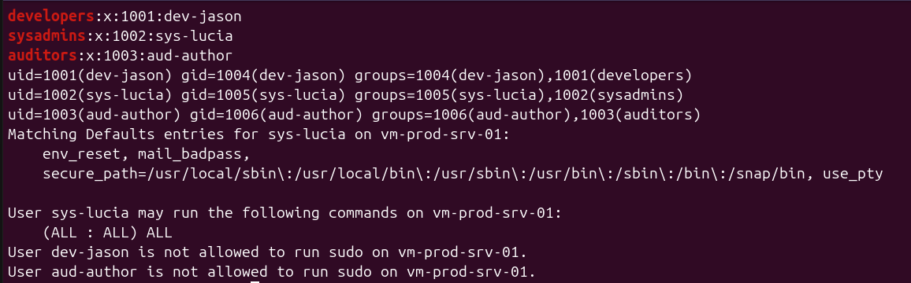
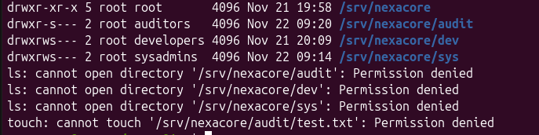
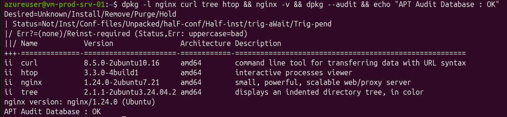
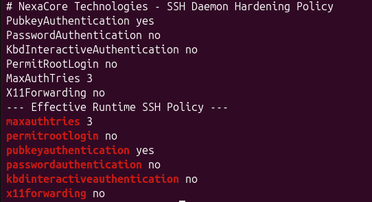
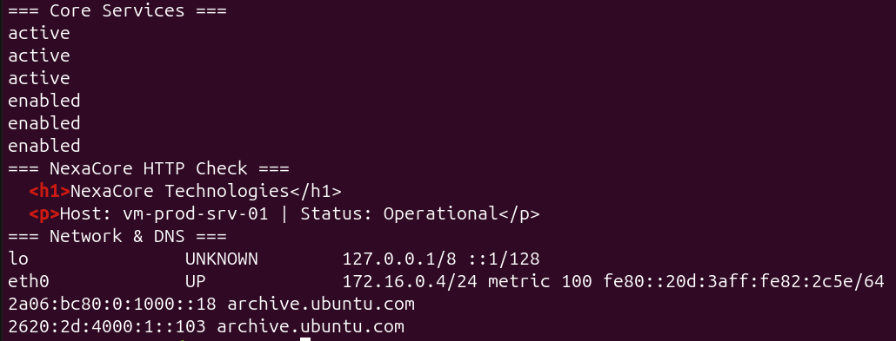
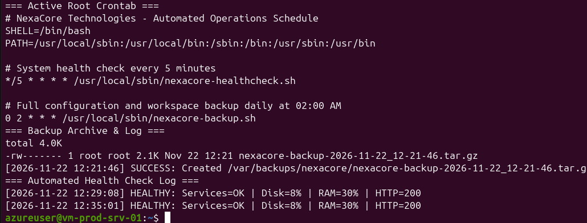

# Secure Linux Server Administration and Management

A hands-on Linux administration project simulating the provisioning, access control, hardening, and operation of an Ubuntu server for a fictional company (**NexaCore Technologies**), built on a Microsoft Azure VM and managed remotely over SSH.

**Skills demonstrated:** `Linux` · `SSH hardening` · `UFW firewall` · `sudo / least privilege` · `file permissions (SGID)` · `systemd` · `journalctl` · `Bash scripting` · `cron` · `Azure VM` · `Git`

---

## Architecture

* **Administrator Workstation (`noebl@nobel`):** Local Ubuntu VM used for SSH administration and Git version control.
* **Managed Server (`vm-prod-srv-01`):** Azure VM running Ubuntu Server 24.04 LTS (`Standard_B2ats_v2`).

```text
+-----------------------------------+          +---------------------------------------------+
|   ADMIN WORKSTATION (Local VM)    |          |      MANAGED CLOUD SERVER (Azure VM)        |
|        Hostname: nobel            |   SSH    |         Hostname: vm-prod-srv-01            |
|        User: noebl                +==========+->       OS: Ubuntu Server 24.04 LTS         |
+-----------------------------------+  TCP/22  |                                             |
                                               |  - Departmental Groups & Least-Privilege    |
                                               |  - SGID Shared Directories (/srv/nexacore)  |
                                               |  - Hardened SSH, UFW, systemd & Backups     |
                                               +---------------------------------------------+
```

---

## Project Highlights

* Created 3 departmental groups with **least-privilege `sudo`** (only `sysadmins` can escalate)
* Built **SGID shared directories** and verified access with positive and negative tests
* Hardened SSH: **Ed25519 key-only login**, root login and password auth disabled
* Configured a **default-deny UFW firewall** aligned with Azure NSG rules
* Diagnosed a simulated Nginx failure using `journalctl` and `nginx -t`
* Automated **daily backups (7-day retention)** and a **5-minute health check** with Bash + cron

---

## Implementation Progress

| Phase | Topic | Status |
| :--- | :--- | :---: |
| 1 | Infrastructure setup & baseline profiling | ✅ |
| 2 | Identity, groups & least-privilege `sudo` | ✅ |
| 3 | Shared filesystem, permissions & SGID | ✅ |
| 4 | Package management (`APT`) | ✅ |
| 5 | SSH key authentication & hardening | ✅ |
| 6 | Host firewall (`UFW`) | ✅ |
| 7 | `systemd`, networking & log diagnostics | ✅ |
| 8 | Automated backups, health checks & `cron` | ✅ |

> Click any phase below to see the details and screenshots.

---

## Phase Details

<details>
<summary><b>Phase 1: Infrastructure Setup & Baseline Profiling</b></summary>

**Objective:** Provision a remote server, connect securely over SSH, and verify baseline resources.

* Created a Git workspace with `.gitignore` rules protecting private keys (`*.pem`, `*.key`, `id_ed25519*`)
* Deployed `vm-prod-srv-01` on Azure (Ubuntu 24.04 LTS) with inbound SSH (`TCP/22`)
* Connected via SSH and checked OS release, kernel, RAM (`free -h`) and disk (`df -h /`)


</details>

<details>
<summary><b>Phase 2: Identity, Groups & Least-Privilege sudo</b></summary>

**Objective:** Isolate three departments and enforce the Principle of Least Privilege.

| Account | Group | `sudo` | Role |
| :--- | :--- | :--- | :--- |
| `dev-jason` | `developers` | Denied | Application development |
| `sys-lucia` | `sysadmins` | Full | Server administration |
| `aud-author` | `auditors` | Denied | Read-only auditing |

* Created groups with `groupadd` and users with `useradd -m -s /bin/bash -G <group>`
* Configured `/etc/sudoers.d/nexacore-sysadmins` (mode `0440`) and validated it with `visudo -c`
* Verified privileges with `sudo -l -U <user>`



</details>

<details>
<summary><b>Phase 3: Shared Filesystem, Permissions & SGID</b></summary>

**Objective:** Build departmental workspaces under `/srv/nexacore` with automatic group inheritance.

| Directory | Owner:Group | Mode | Policy |
| :--- | :--- | :--- | :--- |
| `/srv/nexacore/dev` | `root:developers` | `2770` | Read/write for developers only |
| `/srv/nexacore/sys` | `root:sysadmins` | `2770` | Read/write for sysadmins only |
| `/srv/nexacore/audit` | `root:auditors` | `2750` | Read-only for auditors |

* New files automatically inherit the directory's group (SGID)
* `aud-author` can read audit reports but gets `Permission denied` when entering `dev` or modifying audit files



</details>

<details>
<summary><b>Phase 4: Package & Software Lifecycle (APT)</b></summary>

**Objective:** Maintain patch hygiene and manage packages cleanly.

* Ran `apt update` and `apt upgrade -y`
* Installed `nginx`, `curl`, `tree`, `htop` and inspected packages with `apt show` and `dpkg -l`
* Cleaned up with `apt purge`, `apt autoremove`, `apt autoclean` and checked `dpkg --audit` for broken dependencies



</details>

<details>
<summary><b>Phase 5: SSH Key Authentication & Hardening</b></summary>

**Objective:** Remove password-based brute-force exposure by enforcing key-only SSH.

Config file: `configs/01-nexacore-hardening.conf`

| Directive | Value | Purpose |
| :--- | :--- | :--- |
| `PubkeyAuthentication` | `yes` | Key-pair authentication |
| `PasswordAuthentication` | `no` | Blocks password logins |
| `KbdInteractiveAuthentication` | `no` | Blocks challenge-response fallback |
| `PermitRootLogin` | `no` | Blocks remote root login |
| `MaxAuthTries` | `3` | Limits attempts per connection |
| `X11Forwarding` | `no` | Disables unused GUI forwarding |

* Generated an Ed25519 key (`ssh-keygen -t ed25519`) and deployed it with `ssh-copy-id`
* Validated config with `sshd -t` and checked runtime values with `sshd -T`
* Confirmed password-only login fails with `Permission denied (publickey)`



</details>

<details>
<summary><b>Phase 6: Host Firewall (UFW)</b></summary>

**Objective:** Add a default-deny host firewall aligned with the Azure NSG.

| Rule | Action | Port | Purpose |
| :--- | :--- | :--- | :--- |
| Incoming (default) | `DENY` | All other ports | Blocks unsolicited traffic |
| Outgoing (default) | `ALLOW` | All | Updates, DNS |
| SSH | `ALLOW IN` | `22/tcp` | Remote administration |
| HTTP | `ALLOW IN` | `80/tcp` | Nginx web traffic |

* Allowed SSH **before** enabling UFW to avoid locking myself out
* Checked listening sockets with `ss -tulnp` (only `sshd` and `nginx`)
* Verified that port `80` is reachable and port `8080` is blocked


</details>

<details>
<summary><b>Phase 7: systemd, Networking & Log Diagnostics</b></summary>

**Objective:** Keep services running across reboots and practice failure diagnosis.

| Service | State | Boot | Role |
| :--- | :--- | :--- | :--- |
| `nginx.service` | active (running) | enabled | Web server |
| `ssh.service` | active (running) | enabled | Key-only administration |
| `ufw.service` | active (exited) | enabled | Loads firewall rules at boot |

* Confirmed `systemctl reload nginx` keeps the same `MainPID`
* **Fault simulation:** broke an Nginx drop-in config, found the error with `journalctl -u nginx` and `nginx -t`, then restored the service
* Checked network health with `ip -br a`, `ip route`, `getent hosts` and `journalctl -p err -b`



</details>

<details>
<summary><b>Phase 8: Automated Backups, Health Checks & cron</b></summary>

**Objective:** Automate backups and server monitoring with defensive Bash (`set -euo pipefail`).

| Script | Schedule | Log | Function |
| :--- | :--- | :--- | :--- |
| `scripts/nexacore-backup.sh` | Daily 02:00 | `/var/log/nexacore-backup.log` | Archives `/srv/nexacore`, `sshd_config.d`, `sudoers.d`, `/var/www/html` (mode `0600`), prunes files older than 7 days |
| `scripts/nexacore-healthcheck.sh` | Every 5 min | `/var/log/nexacore-health.log` | Checks `nginx`/`ssh`/`ufw`, disk (80% threshold), RAM, and local HTTP `200` |

* Scripts installed in `/usr/local/sbin/` with `chmod 700`
* Registered in root's `crontab` with explicit `SHELL` and `PATH`
* Confirmed automatic execution in `journalctl -u cron` and the health log



</details>

---

## Repository Structure

```text
secure-linux-server-admin/
├── configs/
│   ├── nexacore-sysadmins.sudoers       # Sanitized sudoers policy
│   └── 01-nexacore-hardening.conf       # SSH hardening config
├── scripts/
│   ├── nexacore-backup.sh               # Daily backup with retention
│   └── nexacore-healthcheck.sh          # Service/disk/RAM/HTTP health check
├── docs/                                # Screenshots and verification output
├── .gitignore                           # Excludes private keys and sensitive files
└── README.md
```

---

## Future Improvements

* Add `fail2ban` for SSH intrusion prevention
* Automate the setup with an Ansible playbook
* Send health-check alerts by email or Slack

---

## Disclaimer

This is a learning lab environment simulating an enterprise setup. No real company data is used.
