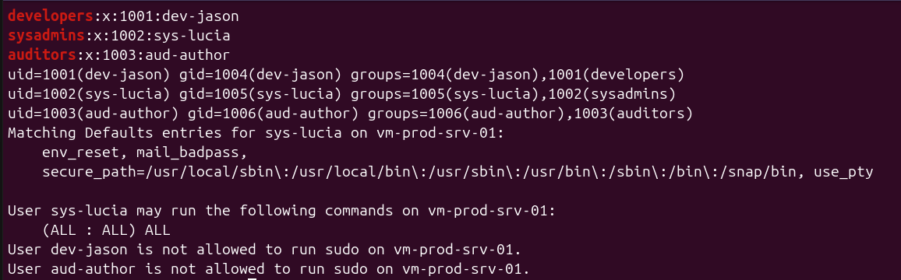

# Phase 2: User, Group & Sudo Administration

- **Groups Created:** `developers`, `sysadmins`, `auditors`
- **Users Created:** `dev-jason` (developers), `sys-lucia` (sysadmins), `aud-author` (auditors)
- **Privilege Policy:** Granted `sudo` access exclusively to `%sysadmins` via `/etc/sudoers.d/nexacore-sysadmins` (permissions `0440`), validated with `visudo -c`.

